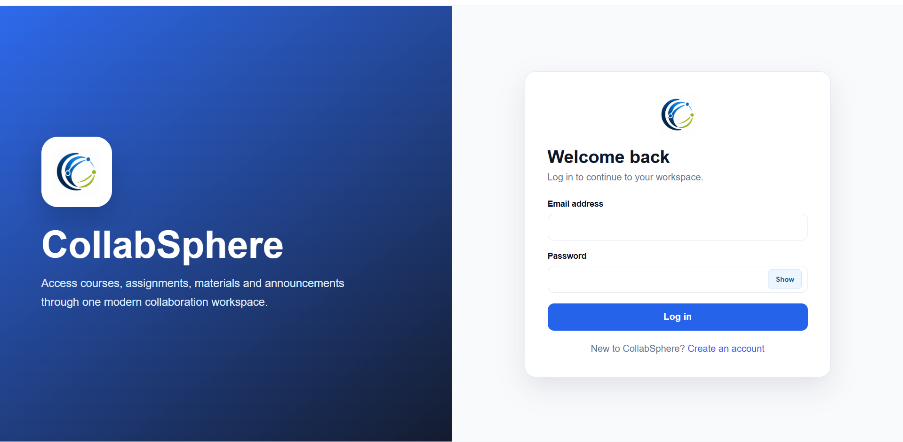
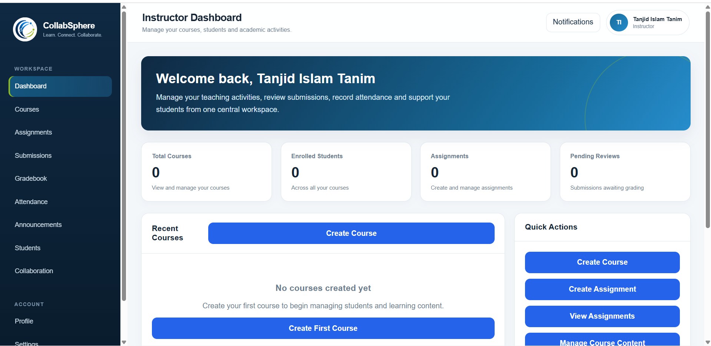
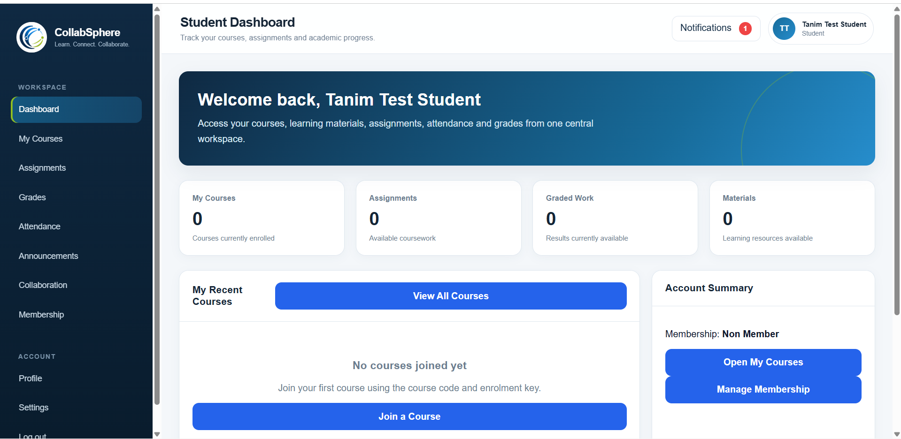
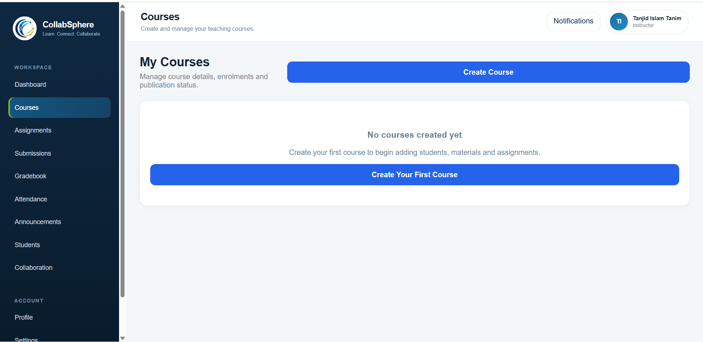
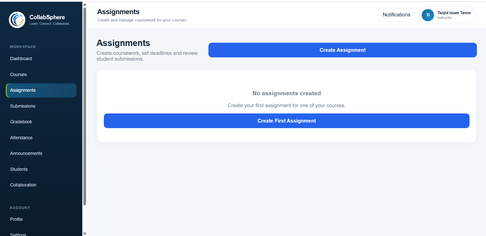
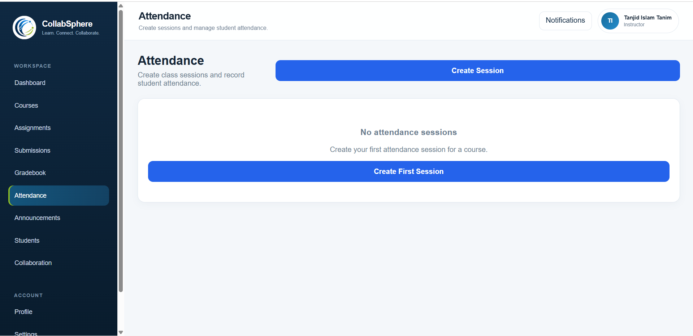
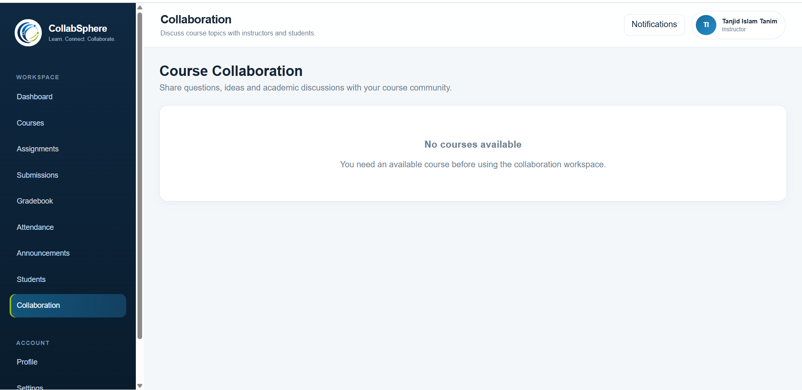
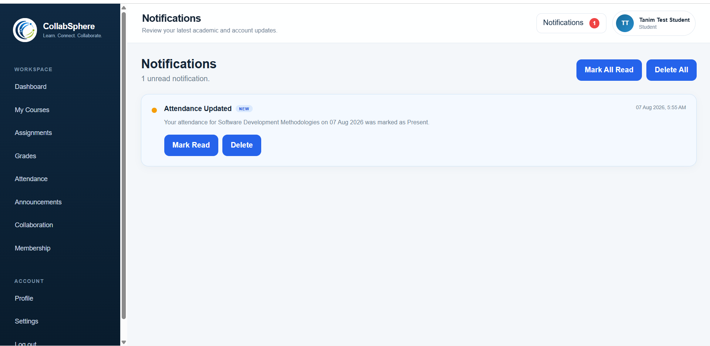

# CollabSphere LMS

> **Project showcase:** [Browse the static portfolio](portfolio/index.html) · [GitHub Pages publishing guide](PORTFOLIO.md)


<p align="center">
  
</p>

<h1 align="center">CollabSphere</h1>

<p align="center"><strong>Learn. Connect. Collaborate.</strong></p>

<p align="center">
A role-based Learning Management System built with PHP, MariaDB, HTML, CSS and JavaScript.
</p>

---

## Overview

CollabSphere is a web-based Learning Management System with dedicated instructor and student workspaces. It supports course management, learning materials, assignments, submissions, grading, attendance, announcements, collaboration, notifications, profiles, settings, and student membership.

## Screenshots

### Login


### Instructor Dashboard


### Student Dashboard


### Course Workspace


### Assignment Submissions


### Attendance


### Collaboration


### Notifications


## Features

### Instructor Workspace
- Create, edit, publish and delete courses
- Manage enrolment keys
- Upload and manage course materials
- Create and manage assignments
- Review submissions
- Grade submissions and publish results
- Create attendance sessions and record attendance
- Publish announcements
- View enrolled students
- Participate in collaboration
- Receive and manage notifications
- Manage profile, password and settings

### Student Workspace
- Join courses using enrolment keys
- Access and download course materials
- View and submit assignments
- View published grades and feedback
- View attendance records
- Read announcements
- Participate in collaboration
- Manage membership status
- Receive and manage notifications
- Manage profile, password and settings

## Technology Stack

| Layer | Technology |
| --- | --- |
| Backend | PHP 8+ |
| Database | MariaDB / MySQL |
| Database Access | PDO |
| Frontend | HTML5, CSS3, JavaScript |
| Web Server | Apache |
| Local Development | XAMPP |
| Version Control | Git & GitHub |

## Project Structure

```text
collabsphere/
├── app/
│   └── Helpers/
├── collaboration/
├── config/
│   ├── app.php
│   └── database.example.php
├── database/
│   └── schema.sql
├── includes/
├── instructor/
├── profile/
├── public/
│   ├── assets/
│   │   ├── css/
│   │   ├── images/
│   │   └── js/
│   └── uploads/
├── student/
├── index.php
├── login.php
├── logout.php
├── notifications.php
└── register.php
```

## Installation

### 1. Clone the repository

```bash
git clone https://github.com/TanjidIslamTanim/CollabSphere-LMS.git
```

### 2. Place the project in XAMPP

```text
C:\xampp\htdocs\collabsphere
```

### 3. Create the database

Create a database named:

```text
collabsphere
```

Then import:

```text
database/schema.sql
```

### 4. Configure the database

Copy:

```text
config/database.example.php
```

and rename the copy to:

```text
config/database.php
```

Then update your local database credentials.

### 5. Start the application

Start Apache and MySQL in XAMPP and open:

```text
http://localhost/collabsphere/
```

## Security

- Passwords use PHP password hashing
- Database access uses PDO prepared statements
- Instructor and student routes use role-based access control
- Local database credentials are excluded from Git
- User-generated uploads are excluded from Git
- Rendered user content is escaped

## Main Modules

| Module | Instructor | Student |
| --- | :---: | :---: |
| Dashboard | ✅ | ✅ |
| Courses | ✅ | ✅ |
| Materials | ✅ | ✅ |
| Assignments | ✅ | ✅ |
| Submissions | ✅ | ✅ |
| Grades / Gradebook | ✅ | ✅ |
| Attendance | ✅ | ✅ |
| Announcements | ✅ | ✅ |
| Collaboration | ✅ | ✅ |
| Notifications | ✅ | ✅ |
| Profile & Settings | ✅ | ✅ |
| Membership | — | ✅ |

## Future Improvements

- REST API
- Flutter or React Native mobile application
- Push notifications
- Email verification and password recovery
- Calendar integration
- Advanced analytics
- Admin workspace
- Real-time discussions
- Cloud file storage
- Production deployment with HTTPS

## Project Status

**Completed and tested locally using XAMPP.**

## Author

**Tanjid Islam Tanim**

Software Engineering Project

---

<p align="center"><strong>CollabSphere — Learn. Connect. Collaborate.</strong></p>
